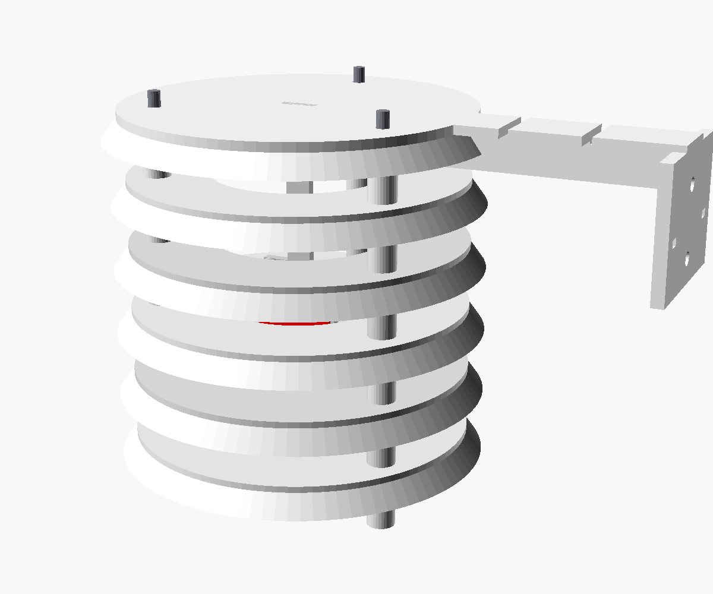
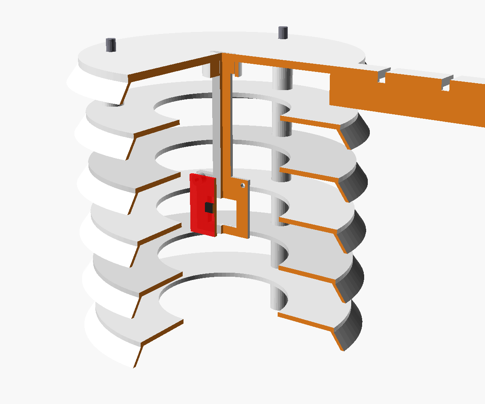
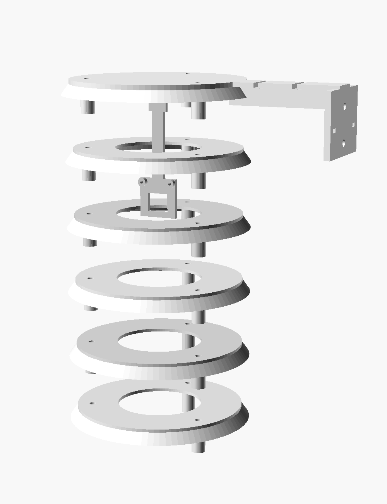
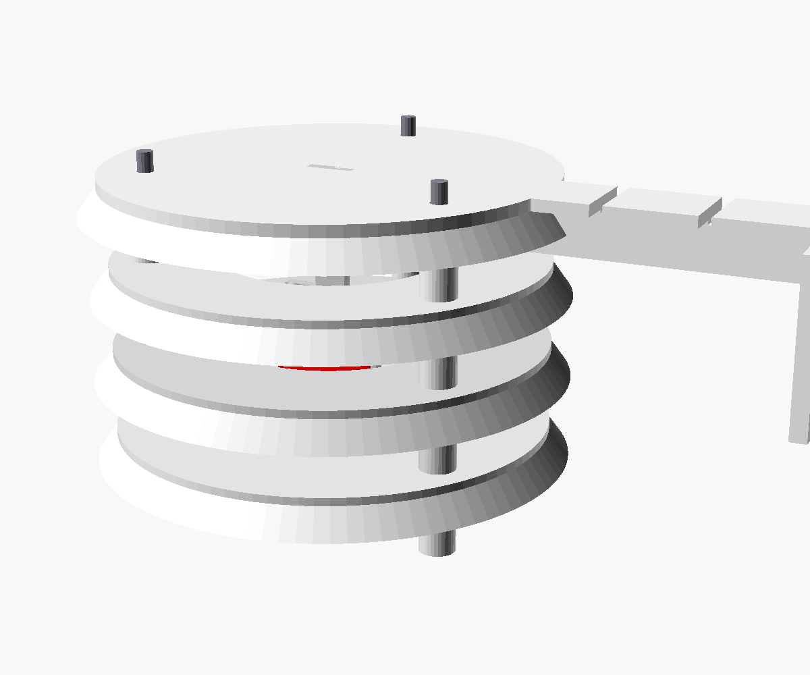

# Sensor radiation shield

A louvred "Stevenson-style" shield for one 1" × 1" Qwiic sensor board
(BME688, SHTC3, SHT45…). In sun a bare sensor reads 10–20 °F high; the
stacked rings shade it while air flows through.



| View | |
|---|---|
| Cutaway (board on its sled, mid-stack) |  |
| Exploded |  |
| 3-ring version for inside the greenhouse |  |

## What to print

| Part | Outside (5 rings) | Inside (3 rings) |
|---|---|---|
| `cap.stl` (cap + wall arm) | 1 | 1 |
| `ring.stl` | 5 | 3 |
| `sled-5ring.stl` / `sled-3ring.stl` | 1 | 1 |

The STLs are already oriented for printing: cap and rings **top-side down**,
sled lying flat. No supports needed (the flared lips are 35° from vertical).

- **Material:** white **ASA** (best outdoors) or white PETG. Not PLA: it
  softens in a hot greenhouse. A print shop's grey/black MJF PA12 works if you
  paint it white.
- 3 walls / 20 % infill is plenty. Outer diameter 120 mm; cap + arm is 187 mm long.

## Hardware

- 3 × M4 threaded rod, stainless: ~140 mm for 5 rings, ~100 mm for 3
- 6 × M4 nuts (+ washers), one above the cap and one under the bottom ring on each rod
- 2 × M2.5 × 6 mm screws: board to sled (the holes are sized for self-tapping)
- 2 × screws for the wall plate; zip ties through the slots hold the QwiicBus board / cable

## Assembly

1. Screw the board to the sled with the **sensor chip facing out** through the window.
2. Push the sled's tongue into the slot under the cap; plug in the Qwiic cable.
3. Thread the rods through the cap, slide the rings on (lips down), nut underneath.
4. Run the cable down through the centre openings and out the bottom.
5. Mount with the arm level, at least 1.5 m above ground, away from walls that
   get sun, ideally on the north side.

## Check before printing

The board holes are assumed 0.8" (20.32 mm) apart, the SparkFun 1" × 1"
standard. Measure yours; if different, change `hole_sp` in `sensor_shield.scad`
and re-export:

```
openscad -D 'part="cap"'  -o cap.stl  sensor_shield.scad
openscad -D 'part="ring"' -o ring.stl sensor_shield.scad
openscad -D 'part="sled"' -D rings=5 -o sled-5ring.stl sensor_shield.scad
```
