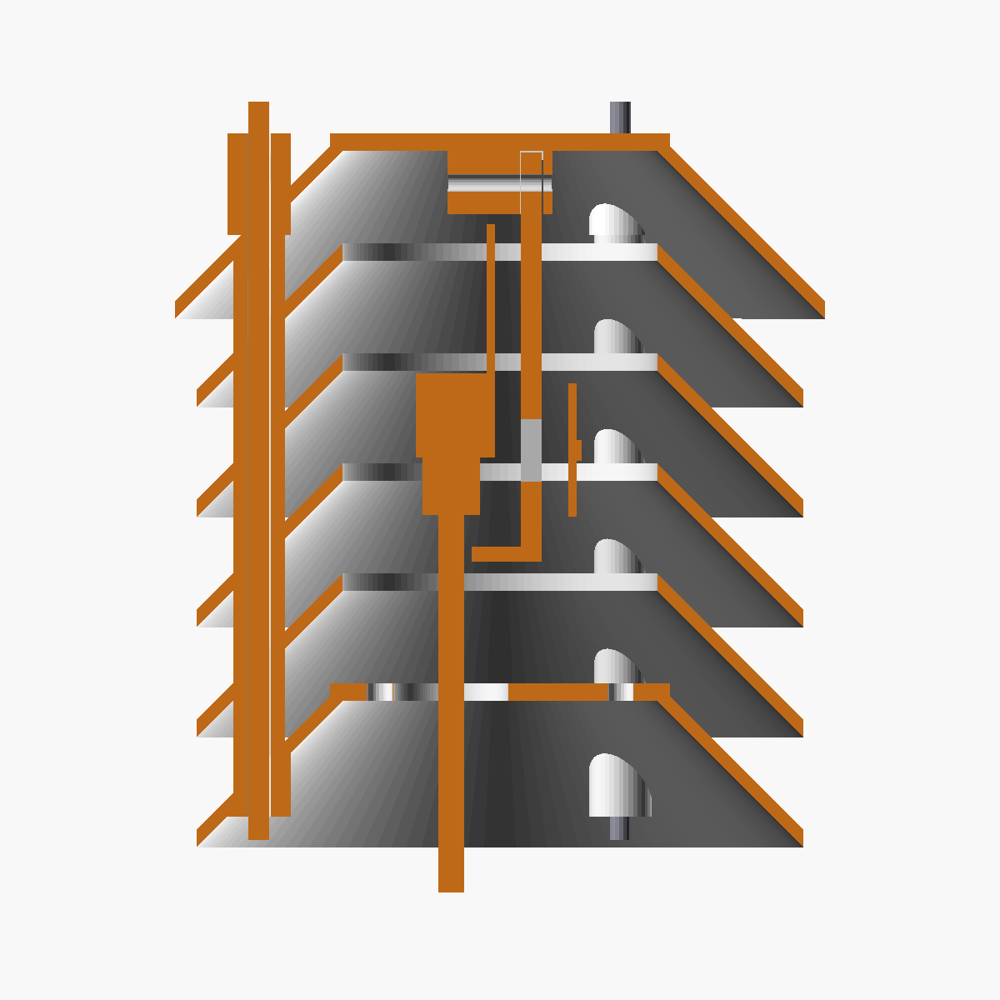
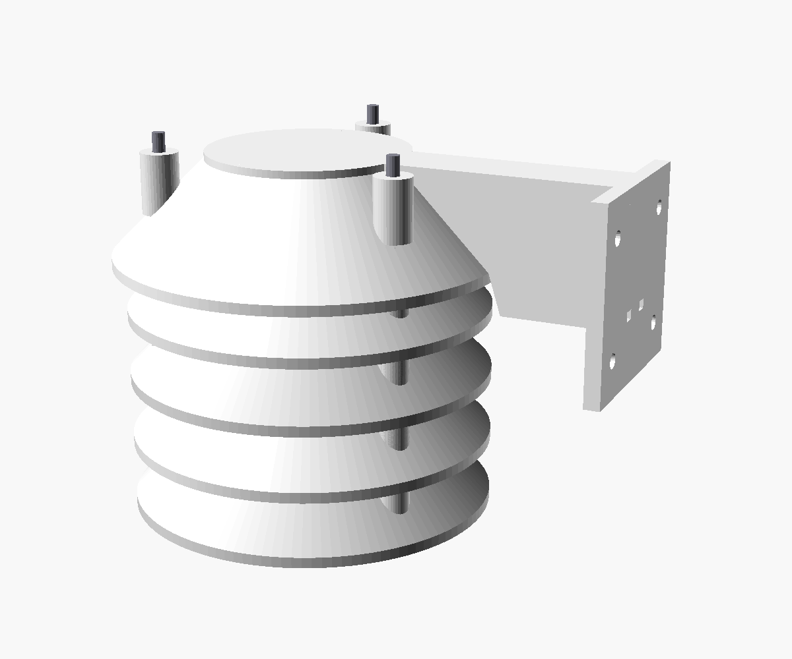

# Sensor radiation shield (v2: wind, snow, Ethernet extender)

A louvred shield for one 1" × 1" Qwiic sensor board (BME688, SHTC3, SHT45…)
**plus the SparkFun QwiicBus EndPoint**, so the Ethernet run from the Pi
plugs straight into the shield. Same parts indoors and outdoors; only the
ring count differs.


| | |
|---|---|
| Cutaway: extender (tall red) on the back of the sled, RJ45 pointing down; sensor on the front; cable out through the floor |  |
| Side section (orange = cut faces): nested 45° louvres, no straight path in |  |
| Exploded |  |
| 4-ring version for inside the greenhouse |  |

## Why it looks like this

- **Sun:** bare sensors read 10–20 °F high in sunlight; the louvres shade it
  while air moves through ~12 mm channels.
- **Snow:** every surface is a 45° slope, so snow slides off instead of
  piling up. Each cone overlaps the one below, so there is no straight path
  in: blown snow has to climb ~40 mm uphill. The bottom ring has a **floor**
  so updrafts can't blow snow up the middle, with **6 drain holes** for
  anything that melts inside.
- **Wind** (Ward gusts 100+ mph): deep ribbed arm, 4-screw wall plate, spacer
  tubes cut to the cone slope (full-face joints, nothing rattles), sled
  locked with an M3 cross-bolt, nylock nuts on the rods.
- **Extender + cable:** the EndPoint sits high on the back of the sled (its
  few mW of warmth rise away from the sensor) with the **RJ45 pointing
  down**, so water can't run into the jack. The Ethernet cable comes straight
  up through the floor hole under it; a zip-tie tab below the plug takes the
  cable's weight off the jack.

## What to print

| Part | Outside (5 rings) | Inside (4 rings) |
|---|---|---|
| `cap.stl` (roof + wall arm), 169 × 124 × 60 mm | 1 | 1 |
| `ring.stl` | 4 | 3 |
| `bottom.stl` (ring with floor) | 1 | 1 |
| `sled-5ring.stl` / `sled-4ring.stl` | 1 | 1 |

STLs are already oriented: cap roof-down, rings narrow-end-down, bottom
floor-down, sled flat. **No supports** (all overhangs are 45°). Use a brim on
the rings (small contact ring).

- **Material:** white **ASA** (best for sun and cold) or white PETG. Not PLA:
  it softens in a hot greenhouse and gets brittle in the cold. Grey/black MJF
  PA12 from a print shop is fine if painted white.
- 3 perimeters, 20–25 % infill.

## Hardware

- 3 × M4 stainless threaded rod: **150 mm** (5 rings) or **130 mm** (4 rings), cut to fit
- 6 × M4 **nylock** nuts + 6 washers
- 1 × M3 × 25 screw + nylock nut (sled cross-bolt)
- 6 × M2.5 × 12 screws + nuts, 6 × M2.5 × 5 mm nylon spacers (4 for the EndPoint, 2–4 for the sensor)
- 1 × 50–100 mm Qwiic cable (EndPoint ↔ sensor)
- 4 × wall screws (#8 / 4 mm), 2–3 small zip ties
- Optional: a little dielectric grease in the RJ45 jack; foam or a split
  grommet around the cable in the floor hole

## Assembly (order matters: the cable goes through before the plug)

1. Bolt the EndPoint to the **back** of the sled on 5 mm spacers, RJ45 at the
   bottom pointing down. Bolt the sensor to the **front** on spacers, chip
   facing out over the air window. Join them with the short Qwiic cable.
2. Feed the Ethernet cable's plug **up through the bottom ring's floor
   hole**, then up through the centre of each ring in order (bottom ring
   first, then the others) like beads.
3. Plug it into the EndPoint and zip-tie the cable to the tab under the jack.
4. Push the sled's tongue into the socket under the cap and fit the M3
   cross-bolt.
5. Rods through the cap's posts, then slide the rings up (cones point up)
   and the bottom ring last; washers + nylock nuts top and bottom. Snug, not
   crushing.
6. Mount with 4 screws, arm level, ~1.5 m up, away from sun-baked walls
   (north side ideal). Leave a **drip loop** in the cable below the shield.

## Check before printing

- Sensor holes assume the SparkFun 1" standard (0.8" = 20.32 mm spacing).
  Measure your board; if different, change `qhole` and re-export.
- EndPoint dimensions come from SparkFun's own board file (44.45 × 25.4 mm,
  holes on a 20.32 mm square).

```
openscad -D 'part="cap"'    -o cap.stl    sensor_shield.scad
openscad -D 'part="ring"'   -o ring.stl   sensor_shield.scad
openscad -D 'part="bottom"' -o bottom.stl sensor_shield.scad
openscad -D 'part="sled"' -D rings=5 -o sled-5ring.stl sensor_shield.scad
```
